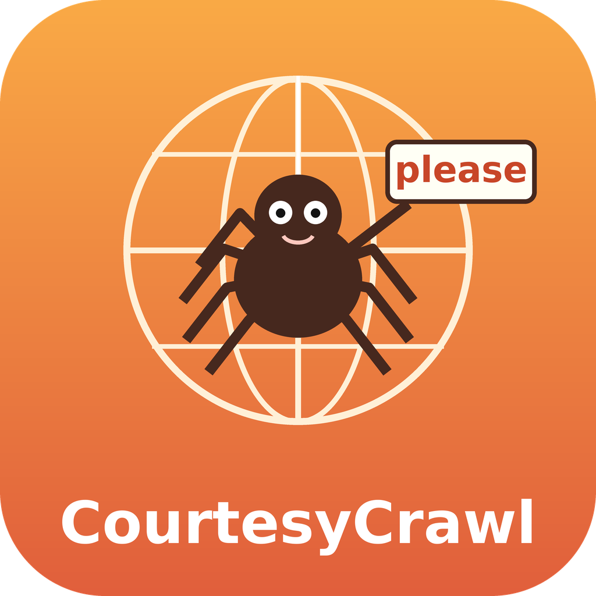

# CourtesyCrawl

CourtesyCrawl is a free helper for doing web research and scraping the legitimate way. It checks for an official API first, reads robots.txt under RFC 9309, reads the site's terms, identifies itself with a contact, goes slowly, and backs off on HTTP 429 and Retry-After. It never bypasses logins, paywalls or CAPTCHAs and never harvests personal data. A small free Python helper script with pinned dependencies is included.



## Project status: done, pending, uncertain
**Done**
- 2026-10-20: v1.0.0 built and tested: manifest valid JSON, frontmatter valid, every documented command run, real robots.txt checks (Wikipedia disallowed path, example.com 404 = allowed), real polite fetch of RFC 9309, and a local 429/Retry-After test (waits, then stops with exit 3).

**Pending**
- Marketplace review: submitted 2026-10-20, pending, no approval yet.
- Translated summaries below are machine-made and not reviewed by native speakers.
- The helper fetches pages only; it does not render JavaScript or parse HTML (by design, to stay small).

**Uncertain**
- Site terms vary and change; CourtesyCrawl reminds the user to read them but cannot read every site's terms for them. Not legal advice.
- `Crawl-delay` is honored but is not part of RFC 9309; sites interpret it differently.
- How the listing works on the Grok Bot and Grok side: not described in the publisher terms.

## Quick start
1. Install (see Installation).
2. Ask: "Can I scrape the product pages on example.com? Do it politely."
3. Get: official-route check, robots.txt result, terms reminder, a slow identified fetch plan, and a report.

## Installation
1. Install from this repository: https://github.com/OmnipotentCEOxJenny/courtesycrawl (Cursor plugin format: `.cursor-plugin/plugin.json`, `skills/`, `rules/`).
2. Optional helper: `pip install -r scripts/requirements.txt` (`requests==2.32.3`, `protego==0.3.1`; tested on Python 3.13). Free and open source.

## Testing
```
pip install -r scripts/requirements.txt
python scripts/courtesy_fetch.py --version
python scripts/courtesy_fetch.py check https://en.wikipedia.org/wiki/Special:Random
python scripts/courtesy_fetch.py check https://example.com/
python scripts/local_test_server.py &
python scripts/courtesy_fetch.py fetch http://127.0.0.1:8765/page http://127.0.0.1:8765/private/x --contact you@example.com --delay 0.5
python scripts/courtesy_fetch.py fetch http://127.0.0.1:8765/always429 --contact you@example.com --delay 0.5
```
Expected: `1.0.0`; Wikipedia Special pages `allowed: no` (exit 1); example.com `allowed: yes` (robots 404); local fetch waits once on 429 then saves `/page` and skips `/private/x` (exit 1); `/always429` waits twice then STOPs (exit 3).

## Credits
- Inventor and publisher: Rob Domaine / Omnipotent Media LLC
- Builder: Jenny Echo
- Standards: RFC 9309, RFC 6585, RFC 9110. robots.txt parsing by protego (BSD-3-Clause).

## Rob Domaine's four pillars
1. Trustworthy, honest, real data, truthful: never invent; anything unchecked is marked UNVERIFIED.
2. Use only legitimate means: legitimate, proven sources and methods; unreliable sources rejected.
3. Double-check everything: every finding is confirmed by two independent checks, and the report shows both.
4. Stay within the law and rules always: local, county, state, federal and platform rules.

## Components
- `skills/courtesy-crawl`: the polite research workflow.
- `skills/check-robots`: robots.txt explained under RFC 9309.
- `scripts/courtesy_fetch.py`, `scripts/requirements.txt`, `scripts/local_test_server.py`: the helper, pinned deps and a local 429 test server.
- `rules/pillars-and-scope.mdc`: the pillars and scope.
- `examples/sample-check.md`: real output.

## Languages
The AI answers in the user's language and keeps commands, file names and status labels unchanged. Title, description and honest-assessment summaries in 23 languages are in [TRANSLATIONS.md](TRANSLATIONS.md): Español, Français, Português, Deutsch, Italiano, Nederlands, Polski, Русский, Українська, Türkçe, العربية, עברית, فارسی, हिन्दी, বাংলা, اردو, 简体中文, 日本語, 한국어, Bahasa Indonesia, Tiếng Việt, Kiswahili, Tagalog / Filipino. They are machine translations, not yet reviewed by native speakers; the English text is authoritative.

## License
MIT. See `LICENSE`.

## Honest assessment: what this plugin cannot do
Written to be fully transparent. If something here is wrong or out of date, please open an issue.

- The helper fetches pages only. It does not render JavaScript or parse HTML.
- It cannot read every site's terms for you; it reminds you to read them.
- `Crawl-delay` is honored but is not part of RFC 9309, and sites interpret it differently.
- By design it never bypasses logins, paywalls or CAPTCHAs and never harvests personal data, so some sites and data are out of reach.
- The optional helper needs Python and two pinned free packages (requests 2.32.3, protego 0.3.1; tested on Python 3.13).
- Marketplace: submitted 2026-10-20 and still pending review; it is not an approved listing yet.
- Translations: the 23 translated summaries in [TRANSLATIONS.md](TRANSLATIONS.md) are machine-made and have not been reviewed by native speakers. The English text is authoritative.
- It is not legal advice and cannot guarantee that any particular use is lawful; you remain responsible for how you use it.
- Rules and compliance: it is built to follow all local, county, state and federal laws and every platform's rules. It uses no paid services, never bypasses logins, paywalls, CAPTCHAs or access controls, and never claims a feature it does not have.
